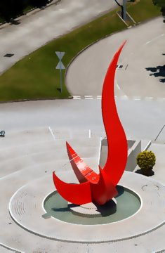

# Time Capsule art assets

To make new art, follow [STYLE.md](STYLE.md). This README lists what already exists.

Roy chose style sheet A. All generated masters use the built-in `gpt-image-2` image tool with the approved sheet as their style reference; the exact prompts and any postprocessing are in `manifest.json`.

PNG masters live in `design/art/`. WebP copies live at matching paths in `public/art/`, except the style sheets and `_checks/`. Names use kebab-case: `<category>-<id>-<part>` where a part exists. Vessel IDs: dome, bottle, envelope, tin, lantern, musicbox, maison, snow-globe, mixtape, instant-camera, ramen, fortune-cookie, red-packet, phone-booth, firefly-jar, hourglass, gashapon, clock-tower, senado-fountain, bamboo-tower, gate-lantern, torii-scroll, palace-pavilion, lionfish-fountain, golden-roof, gate-lacquer, twin-towers, lucky-cat, mooncake-tin, cake-box, candy-box, chocolate-heart, stocking, pumpkin, rice-dumpling, wish-tag, river-lantern. Place IDs: senado, tst-clock, taipei101, sensoji, fushimi, gyeongbok, merlion, grandpal, wumen, petronas, aurele-cotai.

The original SVG art remains in `src/art.js` and is recoverable from Git tag `art-svg-v1`. These bitmap assets are not wired into app screens yet.

## Rules and checks

- T10f-fix: wishing-lamp is redrawn as a traditional antique brass oil lamp with low oval body, long tapering spout, soft smoke at the tip, curled handle and domed lid. Same four filenames and lamp → smoke → lid stack on a 1024 canvas. Measured mouth/pivot 542,685; sparkle 532,662; baseY 889. Lid lifts y −0.40 and fades; smoke drifts up. All other vessel master/export bytes are preserved. Roy approved PR #72; final main refresh and checks precede merge.

- T10f B6: ten original magic and milestone vessels have measured opening and 40/120 px sheets. Roy approved the full batch; PR #71 merged as a8cc451. Layer order, motion and anchors are proposed in the manifest; screen wiring and catalogue changes are separate. The original cylindrical lamp is superseded by T10f-fix below. [B6 contact sheet](_checks/b6-contact-sheet.png).


- T10f B6 spellbook test: closed navy leather book with brass corners/clasp and an abstract star-and-rose motif, complete blank page and rolled letter beneath the front cover. The clasp fades before the cover swings from its measured left-spine pivot. Page-edge glow persists through opening; a 0.025 breathe and glow pulse animate at rest. Exact CLOSED stack, transparent corners, 40/120 px silhouettes, in-canvas open letter and [B6 contact sheet](_checks/b6-contact-sheet.png) were reviewed by Roy. Roy approved the spellbook with brighter golden page-edge and open-page light; glow remains on through opening. No recognizable fantasy-franchise marks were used. The other nine are in progress.

- T10c B3: ten original festival/keepsake vessels, complete reveal edits, exact CLOSED keyframes, measured 40/120 px and opening sheets. Lucky-cat test approved by Roy; its full drawer pulls straight forward with a rolled letter, while approved cat/paw/base/closed bytes remain unchanged. Separate dark interior layers support the pumpkin/river glows; the stocking stand stays fixed while sock/letter sway. Only river water is ground. PR #56 approved and merged as 4309b55. Roy approved T10c-fix PR #61 for merge.
- T10c B3: ten original festival/keepsake vessels, complete reveal edits, exact CLOSED keyframes, measured 40/120 px and opening sheets. Lucky-cat test approved by Roy; its full drawer pulls straight forward with a rolled letter, while approved cat/paw/base/closed bytes remain unchanged. Separate dark interior layers support the pumpkin/river glows; the stocking stand stays fixed while sock/letter sway. Only river water is ground. PR #56 approved and merged as 4309b55. Roy approved T10c-fix PR #61 for merge.
- T10c B3: ten original festival/keepsake vessels, complete reveal edits, exact CLOSED keyframes, measured 40/120 px and opening sheets. Lucky-cat test approved by Roy; its full drawer pulls straight forward with a rolled letter, while approved cat/paw/base/closed bytes remain unchanged. Separate dark interior layers support the pumpkin/river glows; the stocking stand stays fixed while sock/letter sway. Only river water is ground. Final batch approval remains pending.
- Music box and ring box assembled views are closed. Their lids are separate complete parts. Vessel part order and 120 px comparisons are in `_checks/`; lid, flap and cork pivots are in `manifest.json` and `_checks/pivots.json`.
- Dome stack: base → rose → glass. Bottle stack: waves → letter → body → cork. Glass interior alpha below 200 was scaled to 37.5% so contents stay visible.
- All ten portraits are profile pictures (nine people/future presets plus the sea recipient), with an identical 860 px diameter disc centered at (505, 526). `_checks/portraits-small.png` shows 24/40/60 px tests with full-canvas and exact 860 px app-disc crops.
- Passport stamps use one ink color each. Paper textures are opaque and seamlessly tile at all edges. Scene edges fade to transparency.
- A2 idle effects: `vessels/vessel-dome-glint.png` overlays the existing dome glass without changing vessel art; `fx/fx-glint.png` catches on wax seals and brass edges. Roy approved both after `_checks/idle-glint-review.png` showed the dome at 120/240 px and the sparkle at 16/24 px on envelope and tin. `finish-idle-glints.py` downscaled and refined the generated layers.
- T10d B4 full batch: Ten original retro and love vessels have measured closed / half / open sheets (`_checks/<id>-motion.png`), exact resting stacks, 40/120 px strips, transparent PNG masters and WebP exports. Opening ends with each revealed gift visible. [B4 contact sheet](_checks/b4-contact-sheet.png). The screens team will wire their manifest entries separately.
- T10d B4 vinyl test: Roy approved the abstract sleeve and record art. The record rises diagonally, scales to stay fully visible inside the 1024 canvas at opacity 1, and clears the unchanged sleeve. The approved whole-vessel sway remains. The complete hidden disc, sleeve and exact assembled CLOSED stack share one canvas. `_checks/vinyl-motion.png` shows measured opening and anchors; `_checks/vinyl-silhouette.png` shows 40/120 px. Original shapes and abstract sleeve art were checked for text, characters, logos and recognizable brand trade dress.
- T10e B5 full batch: Roy approved PR #70 on 2026-11-08. Ten food and travel vessels have exact CLOSED stacks, complete revealed contents, 40/120 px strips, measured opening sheets and alpha WebP exports. [B5 review notes](_checks/b5-review.md) · [B5 contact sheet](_checks/b5-contact-sheet.png) · [Interactive art review](_checks/b5-review.html). Bento draws box → lid → knot; the knot fades before the lid lifts. Technical layer splits keep the locket stand still during pendant sway and hold the lantern backing steady while its soft halo flickers; the flame stays lit on opening. Glass overlays were adjusted with `adjust-glass-alpha.py` before being composited above their contents. Muted natural food colours follow Roy’s approved exception. Screens and catalogue wiring are separate.
- T10e B5 balloon test: A generic striped hot-air balloon lifts and fades, leaving a complete wicker basket and rolled letter visible. The original generated pixels were normalized onto one 1024 canvas; the assembled CLOSED pose is an exact stack. `_checks/hot-air-balloon-motion.png` shows opening and measured pivot, mouth, base and sparkle; `_checks/hot-air-balloon-silhouette.png` shows 40/120 px. [B5 contact sheet](_checks/b5-contact-sheet.png). IP review found no text, characters, logos or brand shapes. Roy approved the test as shown, including the basket rope ends; all ten B5 vessels were approved in PR #70.
- T10a snow-globe test: original winter scene inside a clear lifting globe, with separate base, scene, drifting snow, glass and idle glint. Its data-driven vessel block follows the PR #42 `IllustratedParts` field names. `_checks/snow-globe-motion.png` shows the measured open keyframes and mouth/sparkle/base anchors; `_checks/snow-globe-silhouette.png` shows 40/120 px. Roy approved this test with a full-clear glass lift and 22 small pale falling snow particles.
- T10a batch 1: all ten vessels follow the approved plan and PR #42 vessel data format. No `ground` layers or split/twist/door roles. Moving layers have measured opening keyframes; snow and sand drift down, steam/fireflies rise. The cassette reels spin independently. Each new vessel has 40/120 px silhouette and closed/half/open motion sheets. The complete camera photo uses its at=0 keyframe for the resting stack; raw part compositing alone would expose it. Pivots and anchors are measured on the normalized canvas. All ten original designs were checked against the plan’s rejected IP ideas; assembled designs were retained. PR #46 review updates redraw the firefly layer as 19 warm golden points that rise/fade, add chopsticks to the ramen lid, keep steam visible, add the six requested whole-vessel idle motions, keep the phone-booth light on, and constrain the fully-out camera photo to the canvas.
- T10a-fix latest review: static jar interior fades from clear light glass at the rim to ink/navy dusk below, with five slender dark grass blades. The drifting firefly layer contains only six gold lights in irregular positions, varied depth/size, and two curved flying trails. Original cloth, glass rim, outline and highlights are retained; opening/idle metadata is unchanged. `_checks/firefly-card-review.png` shows 40/120/240 px and `_checks/firefly-jar-motion.png` has an exact assembled CLOSED panel. Latest script-only review enlarges the glow cores/halos for 120 px while preserving the approved dusk jar exactly. Roy approved the final art in PR #51; the merge refresh preserves its PNG/WebP bytes.
- The built-in image tool returned the map at native 1254 × 1254, its largest square output here; no artificial upscale was used.
- The map entry in `manifest.json` has eleven hand-placed `pins` coordinates in that native 1254 × 1254 pixel space. They follow the illustrative coastlines rather than a precise map projection. `_checks/map-pins.png` overlays their exact points and labels; the Macau boutique pin sits beside Senado Square.
- The T9c pin placement was checked against Roy's supplied world map and an [online East/Southeast Asia map](https://maplab-icon.com/blog-entry-784-html/); [Natural Earth coastlines](https://www.naturalearthdata.com/downloads/10m-physical-vectors/) were consulted for a reliable geographic source. These pins are display positions only; actual location checks use the app's place coordinates.
- `icon-reference.png` is one 4×4 sheet on paper. Row-major order: pin, back, close, plus, lock, check, shop, user, map, cabinet, share, camera, pen; the last three cells are blank. These are references only; the screens team draws final UI icons in code.
- WebP exports use sharp/libvips quality 85 and preserve transparency. Vessel, stamp, portrait and seal exports have max edge 512 px; map has max edge 1600 px. App icon PNG sizes are in `public/icons/`.
- Run checks with the Python scripts in `design/art/scripts/` (Pillow required). Run `npm run build` before merging.

A3 cabinet tiles retain their approved full-width 1024 px exports and geometry: crown 1024×256, repeatable row 1024×384, base 1024×192. They were cut from one generated source; Roy approved `_checks/cabinet-tiles-review.png` at `7b1f646`. The manifest preserves the exact A3 prompts and measured geometry.

- T10b B2: ten original landmark souvenir vessels with complete revealed interiors, exact at=0 stacks, measured motion sheets and 40/120 px silhouettes. Roy requested a tall slender clock tower with a high clock-face door and a 6-degree hands tick; the other nine follow the same silhouette-first review. The clock shape was compared with an [RTHK reference photograph](https://newsstatic.rthk.hk/images/mfile_1832413_1_20251119192432.jpg). Trademarked landmark forms remain loose interpretations; sacred-site vessels use architecture only. `finish-b2.py` prepares layers and `register-b2.py` merges B2 records while preserving other batches. B2 was approved and merged in PR #57. T10b-fix redraws twin-towers as tapered stepped architecture with pointed spires and a lower sky bridge, adding breathe 0.025 to the bridge glow pulse; follow-up approval is pending. The silhouette was inspected against an [Architectural Digest photograph](https://www.architecturaldigest.com/gallery/skyscrapers-you-must-visit-before-you-die) and the [official design reference](https://www.petronastwintowers.com.my/the-towers/design-structure/).

- Public Sea art: `portrait-sea.png` is a non-person recipient picture with the shared circle mask; `scene-sea-sealed.png` is a transparent dusk-sea vignette. Existing master/export hashes are preserved. Exact prompts are in `_checks/prompts-public-sea.json`. Read `docs/design/public-sea.md` from PR #67 (`claude/public-sea`) because it was not yet on main. App registration/wiring is the screens team's follow-up.

## Time Capsule game final art

Sixteen final masters are registered below, with matching WebP exports. Thirteen masters are exact byte copies of Roy's approved concept set at commit `8ad4ed94f59ecd72b7dc8071ee4a965bb580af1d`; the concept branch is read with `git show` and is not merged. The only newly generated pictures are `game/ball-wax.png`, `game/wheel/scene-landmark-taipei.png` and `game/wheel/scene-square.png`. All use Codex's built-in `gpt-image-2`, with the approved style sheet first and the unchanged STYLE section 2 block at the start of every prompt. Exact prompts, ordered references, source commits/hashes and processing are recorded in the new manifest entries; the three new prompt records are also in [_checks/game-final-generation.json](_checks/game-final-generation.json).

- Wax ball: the larger redraw keeps the chosen shallow keyhole, wax-red material, outline and top-left light without gold. Its generated visible alpha crop is downsampled to the gold ball's visible bounds, (152,141)–(871,876), on a transparent 1024 square. The approved 335 px normal source is shown on the left of [_checks/game-final-ball-comparison.png](_checks/game-final-ball-comparison.png), with the larger final master reduced to the same review size on the right. The source is never upscaled.
- Tower scene: only the low city buildings at its foot are replaced with plain modern East Asian buildings and trees. The tower remains a loose interpretation. Square scene: side cottages are replaced with two-storey East Asian shophouses and arched ground floors. Generated scene pixels are downscaled to 1024 and composited only within documented building edit polygons (1.5 px feather). Original pixels outside those masks, including the complete tower/lamp, the distant sky and ground/paving, are retained exactly. No decorative rims, text or frames are baked into the opaque wheel scene masters.
- Common gem alpha bounding box on its 1024 square: **(403,339)–(621,685)**, end exclusive; centre **(512,512)**. Landmark gem stack: **(403,103)–(621,609)**; centre **(512,356)**. Floating markers have no pole, dot or asset shadow. These exact copied canvases are not recentered or re-saved.
- **Inherited check issue:** the approved `cracks/crack-a-large.png` has top-left alpha **238**, with the other three corner pixels zero. Its required exact copy, `game/crack-overlay.png`, retains that pixel. Clearing it would violate the byte-copy requirement. All other required transparent-corner masters pass. Roy should decide whether a later corner cleanup is allowed; the audit reports the failure explicitly.
- Every wheel scene is opaque 1024 × 1024. Six are copied unchanged; only the two requested scenes are edited. The app draws the wheel crop/rim. The special passerby portrait is copied exactly, keeping its approved circle; no portrait remasking or app registration is included. The bench scene is also copied exactly.

### Final art checks and exports

[Final contact sheet](_checks/game-final-contact-sheet.png) shows every final file; the shared contact sheet is unchanged. [Actual-size checks](_checks/game-final-sizes.png) show, from left to right: row 1 normal/gold balls at 64 px, common gem at 48/64 px, Landmark stack at 48/64 px; rows 2–3 the eight wheels in the master-table order at 96 px with script-drawn brass rims; bottom row the passerby portrait at 24/40 px. Gem/ball checks use map land #F3EFE6. [Audit](_checks/game-final-audit.json) records source equality, corners, opacity, preserved scene regions and gem bounds.

Run with Pillow and sharp installed outside the repository:

```sh
/tmp/timecapsule-concept-venv/bin/python design/art/scripts/build-game-final-review.py
SHARP_MODULE_DIR=/tmp/timecapsule-game-final-tools/node_modules/sharp node design/art/scripts/export-webp.cjs --only game/ball-wax.png game/ball-gold.png game/waypost-gem.png game/landmark-gem.png game/crack-overlay.png game/hit-dust.png game/wheel/scene-park.png game/wheel/scene-garden.png game/wheel/scene-waterfront.png game/wheel/scene-square.png game/wheel/scene-public-art.png game/wheel/scene-landmark-taipei.png game/wheel/scene-landmark-singapore.png game/wheel/scene-landmark-macau.png portraits/portrait-passerby.png scenes/scene-passerby-sealed.png
```

The exporter now includes `^game/` in its 512 px rule. Only those sixteen new paths are exported, at quality 85 with alpha retained; the wide bench scene follows the existing scene rule. [WebP audit](_checks/game-final-webp-audit.json) confirms all sixteen export sizes and alpha channels match the sharp resize recipe. [Preservation audit](_checks/game-final-preservation.json) confirms all 1,635 protected tracked files and all 300 existing manifest entries are unchanged. No app code, screen wiring, mobile portrait registration, database change or deployment is part of this work. PR merge waits for Roy's OK.

### Landmark photograph sources and licences

| Scene | Source photo and author | Licence |
| --- | --- | --- |
| Taipei | [Taipei 101 - Taiwan — Ludovic Lubeigt](https://commons.wikimedia.org/wiki/File:Taipei_101_-_Taiwan.jpg) | [CC BY-SA 2.0](https://creativecommons.org/licenses/by-sa/2.0/) |
| Singapore | [Merlion of Singapore — Kistara](https://commons.wikimedia.org/wiki/File:Merlion_of_Singapore.jpg) | [CC0 1.0](https://creativecommons.org/publicdomain/zero/1.0/) |
| Macau | [Senado Square Macao — Georgio](https://commons.wikimedia.org/wiki/File:Senado_Square_Macao.jpg) | [CC BY-SA 3.0](https://creativecommons.org/licenses/by-sa/3.0/) |

These licences describe the inspected photos. No photo pixels are included in the concepts.


## Approved Time Capsule catch background

Roy chose **Option 3 from PR #84 as it is**, with no more trees and no redraw. `game/catch-background.png` is a byte-for-byte copy of `game/catch-background-options/option-3.png` at commit `6acd9e32a391b0c35a3b0730f15e40be42a425fe`. Its SHA-256 is `6843fad4e8eb67f99392dfb567646ba5299a6b73368e7dab8733ba7df3d13588`. No pixels, encoding or native 1024×1536 size changed. The two unchosen option files are removed; the chosen source remains for provenance.

`public/art/game/catch-background.webp` is exported at the full **1024×1536**, quality 85. A single exact-path exception in `export-webp.cjs` bypasses the `game/` 512 px limit for this file only. Run `SHARP_MODULE_DIR=/tmp/timecapsule-game-final-tools/node_modules/sharp node design/art/scripts/export-webp.cjs --only game/catch-background.png`. No other export changes. The app integration is separate; no app code, database, settings or deployment changes are included.

Model: `gpt-image-2` through Codex's built-in image tool. Exact selected prompt verified against generation `6a778803-827a-486a-89e9-609d949837b7`; no generation is performed in Step 2. Ordered references:

1. `design/art/style-sheet.png` at `0357ba6ba7e298251be05084e9da2a62757a55f2`.
2. `design/art/reference/catch-background/fight-scene-now.jpg`.
3. `design/art/reference/catch-background/map-now.jpg`.

The two screenshots are read from `claude/time-capsule-game-journey`, commit `b5f584d7e04681af8eaf613cdc55aa7fd8350dad`; they are not recommitted. The park is invented, not a real place or a map. The opaque portrait layout and map palette are Roy's explicit overrides to STYLE.md. Technical checks are recorded in [_checks/catch-background-audit.json](_checks/catch-background-audit.json); [comparison sheet](_checks/catch-background-options.png) shows the current reference and Roy's chosen option at 375×812. Design assessment is Roy's approval; the selected image is not altered following any further visual review.

Exact generation prompt:

```text
App: 時光膠囊 / Time Capsule. People send a sealed letter that can only be opened at a set time and place. Mood: tender, human, nostalgic, "precious in the AI age". Hand-inked storybook, not glossy 3D.
- Clean ink line art with a slightly hand-drawn line, flat colour fills plus one soft shading tone, a little paper grain, light hatching only (it must still read at about 120 px). Lines in plum #6E2B3F or navy #16263F.
- Palette only: ink blue #2F5D8A, light blue #5A8FD0, glass blue #DCE8F2, plum #6E2B3F, brass #C9A15A, wax red #A3364F, navy #16263F, paper #F6F8FB, cream #F3E2BB. Warm brown wood is allowed for wooden objects.
- Front three-quarter view, soft top-left light. No text, letters, numbers, logos or real brands.
- Transparent background, object centred, generous padding (object fills about 70% of the canvas), square.
Match the attached style sheet exactly.
Override for this image only: replace the style block's transparent, square, object-centred and palette lines with an opaque full-bleed portrait scene, final size exactly 1024×1536. Generate at 1024×1536 or larger at the same aspect ratio; never upscale. This is a quiet background, not an object illustration.
Use the map's colours: land #F3EFE6, park green #DCE6CF, water #BCD3E6, shoreline #9DBBD6, sand path #EFE3C6, buildings #E6E0D3, building tops #EEE9DE, sky glass blue #DCE8F2. Slightly deeper sage greens are allowed for trees and bushes.
Keep the app's hand-drawn storybook quality, with thin soft low-contrast lines and a little paper grain. It must stay quieter and paler than the vessels placed on top of it. Large calm flat shapes, one very soft shading tone, almost no hatching. No dark outlines or strong cast shadows.
Reference 1 is style quality only: do not copy its objects. Reference 2 is the current fight screen: keep its background layout and improve only the drawing, removing every game object and interface. Reference 3 is the live map: match its colours and calm, pale, flat feeling. Draw an original generic city park clearing at ground level, not a real place and not a map. No road through it.
Exact composition on the final 1024×1536 canvas:
Soft simple sky at the top. A row of simple pale low city buildings behind a rounded treeline where the park begins, around y=380. No landmark silhouettes. A small quiet pond is on the left around y=540, reaching in from the left edge, with only a thin soft shoreline. A winding sand footpath on the far right leads from the treeline down to the right edge.
A wide open lighter patch of ground occupies the middle around y=640–880, ready for the app's capsule. The patch is softly irregular, never a precisely outlined oval or circle. A few trees and bushes sit only around the outer edges, as in the current screen: one edge tree on each side near the middle distance, a farther-forward right edge tree and low corner bushes. Gentle lighter ground fills the lower foreground.
Phones crop the sides: keep everything important within x=160–864. Keep x=250–774, y=380–880 calm, open and unobstructed, with no trees, bushes, building edges or path crossing that zone. Pond water may softly touch the far-left margin of this zone but has no decorative detail. Keep x=330–694, y=1180–1440 plain and light for the app's ball. The top 130 px and bottom 130 px are simple quiet background. Only expendable edge foliage may be cropped off the sides.
Do not draw the capsule, wax ball, target rings, Waypost picture, shadows belonging to game objects, buttons, phone frame, interface, labels or any UI from the screenshots. No people, animals or creatures; no text, letters, numbers, logos or brands; no real landmarks; no floating items. This must be original and must not imitate the look of any existing game.
Option variation: Calm bright overcast light, airy broad slightly irregular tree canopies and softly layered dusty sage bushes. Keep the specified palette and exact layout; no rain, fog, fallen leaves or extra objects.
```

- City Hunt art: Letter Keeper from selected sketch A1, matching dialog portrait, all eight player figures on the approved shared adult scale, RGB-only blue Waypost gems, and the ink-blue double-ring Xinyi hunt stamp. Roy approved the first seven assets at `9c247aa`; their PNGs and WebPs remain unchanged. The five remaining figures and stamp await whole-PR approval. No app registration, deployment or merge. Exact prompts, references, scale and preservation hashes are in `_checks/city-hunt-*.json`.

- Red Bird Sundial Box (`red-bird`, 火鳥日晷盒): original low brass sundial keepsake with a wax-red swept pointer inspired by the verified HKUST Piazza sculpture. Closed master, complete rolled-letter interior, back-hinged dial/pointer and soft shadow. The shadow sways 4° about its foot on a 4200ms loop; the rim has a measured sparkle anchor. Earned landmark art only, pending Roy’s visual OK; no app registration, migration, deployment or merge.

- HKUST Passport stamps: single-ring place stamp and double-ring HKUST City Hunt stamp, both ink blue with the curved academic building motif. Roy’s review removes only the place stamp’s inverted triangle by script (1467 pixels); all other place-master pixels are identical. The hunt stamp is a new GPT Image 2 drawing, normalized only with `--only hunt-hkust-2026-11`. Other stamps are byte-identical. Only the hunt image is registered in `mobile/src/art/manifest.ts`; no migration, deployment or merge. Await Roy’s OK.

## Masters

| File | What | Size | Notes |
|---|---|---:|---|
| `game/catch-background.png` | Fight-screen park background | 1024×1536 | Roy-approved Option 3; exact source copy; opaque; full-resolution WebP |
| `game/ball-wax.png` | Wax keyhole ball | 1024×1024 | requested redraw/edit |
| `game/ball-gold.png` | Gold-veined keyhole ball | 1024×1024 | exact approved copy |
| `game/waypost-gem.png` | Floating purple Waypost | 1024×1024 | exact approved copy |
| `game/landmark-gem.png` | Floating Landmark Waypost | 1024×1024 | exact approved copy |
| `game/crack-overlay.png` | Crack A overlay | 1024×1024 | exact approved copy; top-left alpha 238 retained |
| `game/hit-dust.png` | Wax and brass hit dust | 1536×1024 | exact approved copy |
| `portraits/portrait-passerby.png` | Passerby: envelope on a bench | 1024×1024 | exact approved copy |
| `scenes/scene-passerby-sealed.png` | Passerby: sealed bench scene | 1536×1024 | exact approved copy |
| `game/wheel/scene-park.png` | Park | 1024×1024 | exact approved copy |
| `game/wheel/scene-garden.png` | Garden | 1024×1024 | exact approved copy |
| `game/wheel/scene-waterfront.png` | Waterfront | 1024×1024 | exact approved copy |
| `game/wheel/scene-square.png` | Square: shophouses | 1024×1024 | requested redraw/edit |
| `game/wheel/scene-public-art.png` | Public art | 1024×1024 | exact approved copy |
| `game/wheel/scene-landmark-taipei.png` | Landmark: Taipei | 1024×1024 | requested redraw/edit |
| `game/wheel/scene-landmark-singapore.png` | Landmark: Singapore | 1024×1024 | exact approved copy |
| `game/wheel/scene-landmark-macau.png` | Landmark: Macau | 1024×1024 | exact approved copy |
| `app-icon.png` | Blue rose dome app icon master | 1024×1024 | opaque |
| `cabinet/cabinet-base.png` | Tiling cabinet base with brass feet | 1024×192 | processed; see manifest |
| `cabinet/cabinet-crown.png` | Tiling cabinet crown with brass finials | 1024×256 | processed; see manifest |
| `cabinet/cabinet-row.png` | One repeatable cabinet shelf row | 1024×384 | processed; see manifest |
| `cabinet/cabinet-wall.png` | Warm plaster and wood-panel wall | 1024×1536 | opaque |
| `fx/fx-glint.png` | Small four-point idle sparkle for wax and brass | 1024×1024 | processed; see manifest |
| `fx/fx-light-burst.png` | Warm radial opening light effect | 1024×1024 | processed; see manifest |
| `icon-reference.png` | Thirteen UI icon reference grid | 1024×1024 | opaque |
| `journey/passport-cover.png` | Navy and brass passport cover | 1024×1536 | opaque |
| `journey/passport-page.png` | Blank cream passport page | 1024×1536 | opaque |
| `map-asia.png` | Simplified East and Southeast Asia journey map | 1254×1254 | opaque |
| `portraits/portrait-01.png` | Main profile picture preset 01 | 1024×1024 | processed; see manifest |
| `portraits/portrait-02.png` | Main profile picture preset 02 | 1024×1024 | processed; see manifest |
| `portraits/portrait-03.png` | Main profile picture preset 03 | 1024×1024 | processed; see manifest |
| `portraits/portrait-04.png` | Main profile picture preset 04 | 1024×1024 | processed; see manifest |
| `portraits/portrait-05.png` | Main profile picture preset 05 | 1024×1024 | processed; see manifest |
| `portraits/portrait-06.png` | Main profile picture preset 06 | 1024×1024 | processed; see manifest |
| `portraits/portrait-07.png` | Main profile picture preset 07 | 1024×1024 | processed; see manifest |
| `portraits/portrait-08.png` | Main profile picture preset 08 | 1024×1024 | processed; see manifest |
| `portraits/portrait-future.png` | Main profile picture: future self | 1024×1024 | processed; see manifest |
| `portraits/portrait-sea.png` | Sea recipient profile picture: message bottle on a dusk sea | 1024×1024 | processed; see manifest |
| `scenes/scene-empty-inbox.png` | Empty inbox: open shelf space and waiting bird | 1536×1024 |  |
| `scenes/scene-empty-sent.png` | Empty sent: blank letter, pen and wax | 1536×1024 |  |
| `scenes/scene-sea-sealed.png` | Sea bottle sent: drifting away toward a quiet dusk shore | 1536×1024 | processed; see manifest |
| `scenes/scene-sealed.png` | Letter being sealed with warm glow | 1536×1024 |  |
| `scenes/scene-welcome.png` | Welcome: hands, sealed letter and dome rose | 1536×1024 |  |
| `seal-wax.png` | Large rose-imprinted wax seal | 1024×1024 |  |
| `shelf.png` | Empty three-level wooden display shelf | 1024×1024 |  |
| `stamps/stamp-aurele-cotai.png` | One-color passport stamp: Maison Aurèle Cotai boutique demo | 1024×1024 | processed; see manifest |
| `stamps/stamp-fushimi.png` | One-color passport stamp: Fushimi Inari | 1024×1024 | processed; see manifest |
| `stamps/stamp-grandpal.png` | One-color passport stamp: Grand Palace | 1024×1024 | processed; see manifest |
| `stamps/stamp-gyeongbok.png` | One-color passport stamp: Gyeongbokgung | 1024×1024 | processed; see manifest |
| `stamps/stamp-merlion.png` | One-color passport stamp: Merlion | 1024×1024 | processed; see manifest |
| `stamps/stamp-petronas.png` | One-color passport stamp: Petronas Towers | 1024×1024 | processed; see manifest |
| `stamps/stamp-senado.png` | One-color passport stamp: Senado Square | 1024×1024 | processed; see manifest |
| `stamps/stamp-sensoji.png` | One-color passport stamp: Sensō-ji | 1024×1024 | processed; see manifest |
| `stamps/stamp-taipei101.png` | One-color passport stamp: Taipei 101 | 1024×1024 | processed; see manifest |
| `stamps/stamp-tst-clock.png` | One-color passport stamp: Tsim Sha Tsui Clock Tower | 1024×1024 | processed; see manifest |
| `stamps/stamp-wumen.png` | One-color passport stamp: Forbidden City Meridian Gate | 1024×1024 | processed; see manifest |
| `style-sheet-a.png` | Style sheet A candidate | 1536×1024 | opaque |
| `style-sheet-b.png` | Style sheet B candidate | 1536×1024 | opaque |
| `style-sheet-c.png` | Style sheet C candidate | 1536×1024 | opaque |
| `style-sheet.png` | Roy-approved style sheet A | 1536×1024 | opaque |
| `textures/paper-letter.png` | Warm seamless letter-paper texture | 1024×1024 | processed; see manifest, opaque |
| `textures/paper.png` | Cool seamless paper texture | 1024×1024 | processed; see manifest, opaque |
| `vessels/vessel-arcade-cabinet.png` | arcade — cabinet layer | 1024×1024 | processed; see manifest |
| `vessels/vessel-arcade-door.png` | arcade — door layer | 1024×1024 | processed; see manifest |
| `vessels/vessel-arcade-screen.png` | arcade — screen layer | 1024×1024 | processed; see manifest |
| `vessels/vessel-arcade.png` | Assembled arcade vessel | 1024×1024 | processed; see manifest |
| `vessels/vessel-baby-shoes-box.png` | baby-shoes box layer | 1024×1024 | processed; see manifest |
| `vessels/vessel-baby-shoes-lid.png` | baby-shoes lid layer | 1024×1024 | processed; see manifest |
| `vessels/vessel-baby-shoes.png` | baby-shoes assembled vessel | 1024×1024 | processed; see manifest |
| `vessels/vessel-bamboo-tower-tin.png` | Bamboo-Tier Skyscraper Tin — tin layer | 1024×1024 | processed; see manifest |
| `vessels/vessel-bamboo-tower-top.png` | Bamboo-Tier Skyscraper Tin — top layer | 1024×1024 | processed; see manifest |
| `vessels/vessel-bamboo-tower.png` | Assembled bamboo-tier skyscraper tin vessel | 1024×1024 | processed; see manifest |
| `vessels/vessel-bento-box.png` | bento — box layer | 1024×1024 | processed; see manifest |
| `vessels/vessel-bento-knot.png` | bento — knot layer | 1024×1024 | processed; see manifest |
| `vessels/vessel-bento-lid.png` | bento — lid layer | 1024×1024 | pivot 518,503, processed; see manifest |
| `vessels/vessel-bento.png` | Assembled bento vessel | 1024×1024 | processed; see manifest |
| `vessels/vessel-bottle-body.png` | Message In A Bottle — body layer | 1024×1024 | processed; see manifest |
| `vessels/vessel-bottle-cork.png` | Message In A Bottle — cork layer | 1024×1024 | pivot 724,355 |
| `vessels/vessel-bottle-letter.png` | Message In A Bottle — letter layer | 1024×1024 |  |
| `vessels/vessel-bottle-waves.png` | Message In A Bottle — waves layer | 1024×1024 |  |
| `vessels/vessel-bottle.png` | Assembled message in a bottle vessel | 1024×1024 |  |
| `vessels/vessel-bubble-tea-cup.png` | bubble-tea — cup layer | 1024×1024 | processed; see manifest |
| `vessels/vessel-bubble-tea-lid.png` | bubble-tea — lid layer | 1024×1024 | pivot 513,391, processed; see manifest |
| `vessels/vessel-bubble-tea.png` | Assembled bubble-tea vessel | 1024×1024 | processed; see manifest |
| `vessels/vessel-cake-box-box.png` | Windowed birthday cake box — box layer | 1024×1024 | processed; see manifest |
| `vessels/vessel-cake-box-flame.png` | Windowed birthday cake box — flame layer | 1024×1024 | processed; see manifest |
| `vessels/vessel-cake-box-lid.png` | Windowed birthday cake box — lid layer | 1024×1024 | processed; see manifest |
| `vessels/vessel-cake-box.png` | Windowed birthday cake box — assembled closed | 1024×1024 | processed; see manifest |
| `vessels/vessel-camp-lantern-backing.png` | camp-lantern — backing layer | 1024×1024 | processed; see manifest |
| `vessels/vessel-camp-lantern-cap.png` | camp-lantern — cap layer | 1024×1024 | pivot 518,357, processed; see manifest |
| `vessels/vessel-camp-lantern-glow.png` | camp-lantern — glow layer | 1024×1024 | processed; see manifest |
| `vessels/vessel-camp-lantern-lantern.png` | camp-lantern — lantern layer | 1024×1024 | processed; see manifest |
| `vessels/vessel-camp-lantern.png` | Assembled camp-lantern vessel | 1024×1024 | processed; see manifest |
| `vessels/vessel-candy-box-box.png` | Octagonal eight-compartment New Year candy box — box layer | 1024×1024 | processed; see manifest |
| `vessels/vessel-candy-box-lid.png` | Octagonal eight-compartment New Year candy box — lid layer | 1024×1024 | pivot 512,233, processed; see manifest |
| `vessels/vessel-candy-box.png` | Octagonal eight-compartment New Year candy box — assembled closed | 1024×1024 | processed; see manifest |
| `vessels/vessel-chocolate-heart-box.png` | Ribboned heart chocolate box — box layer | 1024×1024 | processed; see manifest |
| `vessels/vessel-chocolate-heart-lid.png` | Ribboned heart chocolate box — lid layer | 1024×1024 | processed; see manifest |
| `vessels/vessel-chocolate-heart.png` | Ribboned heart chocolate box — assembled closed | 1024×1024 | processed; see manifest |
| `vessels/vessel-clock-tower-door.png` | Small Standing Clock-Tower Keepsake — door layer | 1024×1024 | processed; see manifest |
| `vessels/vessel-clock-tower-hands.png` | Small Standing Clock-Tower Keepsake — hands layer | 1024×1024 | processed; see manifest |
| `vessels/vessel-clock-tower-tower.png` | Small Standing Clock-Tower Keepsake — tower layer | 1024×1024 | processed; see manifest |
| `vessels/vessel-clock-tower.png` | Assembled small standing clock-tower keepsake vessel | 1024×1024 | processed; see manifest |
| `vessels/vessel-crystal-ball-ball.png` | crystal-ball ball layer | 1024×1024 | processed; see manifest |
| `vessels/vessel-crystal-ball-mist.png` | crystal-ball mist layer | 1024×1024 | processed; see manifest |
| `vessels/vessel-crystal-ball-stand.png` | crystal-ball stand layer | 1024×1024 | processed; see manifest |
| `vessels/vessel-crystal-ball.png` | crystal-ball assembled vessel | 1024×1024 | processed; see manifest |
| `vessels/vessel-dim-sum-steamer-lid.png` | dim-sum-steamer — lid layer | 1024×1024 | pivot 522,519, processed; see manifest |
| `vessels/vessel-dim-sum-steamer-steam.png` | dim-sum-steamer — steam layer | 1024×1024 | processed; see manifest |
| `vessels/vessel-dim-sum-steamer-steamer.png` | dim-sum-steamer — steamer layer | 1024×1024 | processed; see manifest |
| `vessels/vessel-dim-sum-steamer.png` | Assembled dim-sum-steamer vessel | 1024×1024 | processed; see manifest |
| `vessels/vessel-diploma-tube-cap.png` | diploma-tube cap layer | 1024×1024 | processed; see manifest |
| `vessels/vessel-diploma-tube-diploma.png` | diploma-tube diploma layer | 1024×1024 | processed; see manifest |
| `vessels/vessel-diploma-tube-tube.png` | diploma-tube tube layer | 1024×1024 | processed; see manifest |
| `vessels/vessel-diploma-tube.png` | diploma-tube assembled vessel | 1024×1024 | processed; see manifest |
| `vessels/vessel-dome-base.png` | Glass-Dome Blue Rose — base layer | 1024×1024 |  |
| `vessels/vessel-dome-glass.png` | Glass-Dome Blue Rose — glass layer | 1024×1024 | processed; see manifest |
| `vessels/vessel-dome-glint.png` | Travelling highlight for the dome glass | 1024×1024 | processed; see manifest |
| `vessels/vessel-dome-rose.png` | Glass-Dome Blue Rose — rose layer | 1024×1024 |  |
| `vessels/vessel-dome.png` | Assembled glass-dome blue rose vessel | 1024×1024 |  |
| `vessels/vessel-envelope-body.png` | Wax-Sealed Letter — body layer | 1024×1024 |  |
| `vessels/vessel-envelope-flap.png` | Wax-Sealed Letter — flap layer | 1024×1024 | pivot 496,260 |
| `vessels/vessel-envelope-seal.png` | Wax-Sealed Letter — seal layer | 1024×1024 |  |
| `vessels/vessel-envelope.png` | Assembled wax-sealed letter vessel | 1024×1024 |  |
| `vessels/vessel-escape-pod-glow.png` | escape-pod glow layer | 1024×1024 | processed; see manifest |
| `vessels/vessel-escape-pod-hatch.png` | escape-pod hatch layer | 1024×1024 | processed; see manifest |
| `vessels/vessel-escape-pod-pod.png` | escape-pod pod layer | 1024×1024 | processed; see manifest |
| `vessels/vessel-escape-pod.png` | escape-pod assembled vessel | 1024×1024 | processed; see manifest |
| `vessels/vessel-firefly-jar-fireflies.png` | Cloth-Covered Firefly Jar — fireflies layer | 1024×1024 | processed; see manifest |
| `vessels/vessel-firefly-jar-jar.png` | Cloth-Covered Firefly Jar — jar layer | 1024×1024 | processed; see manifest |
| `vessels/vessel-firefly-jar-lid.png` | Cloth-Covered Firefly Jar — lid layer | 1024×1024 | processed; see manifest |
| `vessels/vessel-firefly-jar.png` | Assembled cloth-covered firefly jar vessel | 1024×1024 | processed; see manifest |
| `vessels/vessel-fortune-cookie-left.png` | Fortune Cookie On A Plate — left layer | 1024×1024 | processed; see manifest |
| `vessels/vessel-fortune-cookie-plate.png` | Fortune Cookie On A Plate — plate layer | 1024×1024 | processed; see manifest |
| `vessels/vessel-fortune-cookie-right.png` | Fortune Cookie On A Plate — right layer | 1024×1024 | processed; see manifest |
| `vessels/vessel-fortune-cookie-slip.png` | Fortune Cookie On A Plate — slip layer | 1024×1024 | processed; see manifest |
| `vessels/vessel-fortune-cookie.png` | Assembled fortune cookie on a plate vessel | 1024×1024 | processed; see manifest |
| `vessels/vessel-gashapon-bottom.png` | Pastel Clear-Top Toy Capsule — bottom layer | 1024×1024 | processed; see manifest |
| `vessels/vessel-gashapon-top.png` | Pastel Clear-Top Toy Capsule — top layer | 1024×1024 | processed; see manifest |
| `vessels/vessel-gashapon.png` | Assembled pastel clear-top toy capsule vessel | 1024×1024 | processed; see manifest |
| `vessels/vessel-gate-lacquer-box.png` | Imperial-Gate Lacquer Box — box layer | 1024×1024 | processed; see manifest |
| `vessels/vessel-gate-lacquer-roof.png` | Imperial-Gate Lacquer Box — roof layer | 1024×1024 | processed; see manifest |
| `vessels/vessel-gate-lacquer.png` | Assembled imperial-gate lacquer box vessel | 1024×1024 | processed; see manifest |
| `vessels/vessel-gate-lantern-cap.png` | Great Red Gate Lantern — cap layer | 1024×1024 | processed; see manifest |
| `vessels/vessel-gate-lantern-glow.png` | Great Red Gate Lantern — glow layer | 1024×1024 | processed; see manifest |
| `vessels/vessel-gate-lantern-lantern.png` | Great Red Gate Lantern — lantern layer | 1024×1024 | processed; see manifest |
| `vessels/vessel-gate-lantern.png` | Assembled great red gate lantern vessel | 1024×1024 | processed; see manifest |
| `vessels/vessel-golden-roof-box.png` | Thai Golden-Roof Jewel Box — box layer | 1024×1024 | processed; see manifest |
| `vessels/vessel-golden-roof-roof.png` | Thai Golden-Roof Jewel Box — roof layer | 1024×1024 | processed; see manifest |
| `vessels/vessel-golden-roof.png` | Assembled Thai golden-roof jewel box vessel | 1024×1024 | processed; see manifest |
| `vessels/vessel-heart-locket-back.png` | heart-locket — back layer | 1024×1024 | processed; see manifest |
| `vessels/vessel-heart-locket-front.png` | heart-locket — front layer | 1024×1024 | pivot 414,550, processed; see manifest |
| `vessels/vessel-heart-locket-stand.png` | heart-locket — stand layer | 1024×1024 | processed; see manifest |
| `vessels/vessel-heart-locket.png` | Assembled heart-locket vessel | 1024×1024 | processed; see manifest |
| `vessels/vessel-hot-air-balloon-balloon.png` | Hot-air balloon — lift-off striped envelope | 1024×1024 | processed; see manifest |
| `vessels/vessel-hot-air-balloon-basket.png` | Hot-air balloon — static wicker basket and rolled letter | 1024×1024 | processed; see manifest |
| `vessels/vessel-hot-air-balloon.png` | Assembled original hot-air balloon vessel | 1024×1024 | processed; see manifest |
| `vessels/vessel-hourglass-cap.png` | Wood And Brass Hourglass — cap layer | 1024×1024 | processed; see manifest |
| `vessels/vessel-hourglass-frame-and-glass.png` | Wood And Brass Hourglass — frame-and-glass layer | 1024×1024 | processed; see manifest |
| `vessels/vessel-hourglass-sand.png` | Wood And Brass Hourglass — sand layer | 1024×1024 | processed; see manifest |
| `vessels/vessel-hourglass.png` | Assembled wood and brass hourglass vessel | 1024×1024 | processed; see manifest |
| `vessels/vessel-instant-camera-camera.png` | Original Instant Camera — camera layer | 1024×1024 | processed; see manifest |
| `vessels/vessel-instant-camera-photo.png` | Original Instant Camera — photo layer | 1024×1024 | processed; see manifest |
| `vessels/vessel-instant-camera.png` | Assembled original instant camera vessel | 1024×1024 | processed; see manifest |
| `vessels/vessel-lantern-body.png` | Mid-Autumn Lantern — body layer | 1024×1024 |  |
| `vessels/vessel-lantern-cap.png` | Mid-Autumn Lantern — cap layer | 1024×1024 |  |
| `vessels/vessel-lantern-glow.png` | Mid-Autumn Lantern — glow layer | 1024×1024 |  |
| `vessels/vessel-lantern.png` | Assembled Mid-Autumn lantern vessel | 1024×1024 |  |
| `vessels/vessel-lionfish-fountain-bottle.png` | Lion-Head Fish-Scale Fountain Bottle — bottle layer | 1024×1024 | processed; see manifest |
| `vessels/vessel-lionfish-fountain-spray.png` | Lion-Head Fish-Scale Fountain Bottle — spray layer | 1024×1024 | processed; see manifest |
| `vessels/vessel-lionfish-fountain-stopper.png` | Lion-Head Fish-Scale Fountain Bottle — stopper layer | 1024×1024 | processed; see manifest |
| `vessels/vessel-lionfish-fountain.png` | Assembled lion-head fish-scale fountain bottle vessel | 1024×1024 | processed; see manifest |
| `vessels/vessel-love-padlock-lock.png` | love-padlock — lock layer | 1024×1024 | processed; see manifest |
| `vessels/vessel-love-padlock-shackle.png` | love-padlock — shackle layer | 1024×1024 | processed; see manifest |
| `vessels/vessel-love-padlock.png` | Assembled love-padlock vessel | 1024×1024 | processed; see manifest |
| `vessels/vessel-lucky-cat-cat.png` | Folk lucky cat with letter drawer — cat layer | 1024×1024 | processed; see manifest |
| `vessels/vessel-lucky-cat-drawer-closed.png` | Folk lucky cat with letter drawer — drawer-closed layer | 1024×1024 | processed; see manifest |
| `vessels/vessel-lucky-cat-drawer.png` | Folk lucky cat with letter drawer — drawer layer | 1024×1024 | pivot 532,812, processed; see manifest |
| `vessels/vessel-lucky-cat-paw.png` | Folk lucky cat with letter drawer — paw layer | 1024×1024 | pivot 652,420, processed; see manifest |
| `vessels/vessel-lucky-cat.png` | Folk lucky cat with letter drawer — assembled closed | 1024×1024 | processed; see manifest |
| `vessels/vessel-lucky-stars-glint.png` | Lucky stars jar glass glint | 1024×1024 | processed; see manifest |
| `vessels/vessel-lucky-stars-jar.png` | lucky-stars — jar layer | 1024×1024 | processed; see manifest |
| `vessels/vessel-lucky-stars-lid.png` | lucky-stars — lid layer | 1024×1024 | processed; see manifest |
| `vessels/vessel-lucky-stars.png` | Assembled lucky-stars vessel | 1024×1024 | processed; see manifest |
| `vessels/vessel-maison-box.png` | Maison Aurèle Ring Box — box layer | 1024×1024 |  |
| `vessels/vessel-maison-lid.png` | Maison Aurèle Ring Box — lid layer | 1024×1024 | pivot 605,300 |
| `vessels/vessel-maison-ring.png` | Maison Aurèle Ring Box — ring layer | 1024×1024 |  |
| `vessels/vessel-maison.png` | Assembled Maison Aurèle ring box vessel | 1024×1024 |  |
| `vessels/vessel-memorial-candle-glow.png` | memorial-candle glow layer | 1024×1024 | processed; see manifest |
| `vessels/vessel-memorial-candle-jar.png` | memorial-candle jar layer | 1024×1024 | processed; see manifest |
| `vessels/vessel-memorial-candle-lid.png` | memorial-candle lid layer | 1024×1024 | processed; see manifest |
| `vessels/vessel-memorial-candle.png` | memorial-candle assembled vessel | 1024×1024 | processed; see manifest |
| `vessels/vessel-mixtape-case.png` | Cassette In A Clear Case — case layer | 1024×1024 | processed; see manifest |
| `vessels/vessel-mixtape-cassette.png` | Cassette In A Clear Case — cassette layer | 1024×1024 | processed; see manifest |
| `vessels/vessel-mixtape-glint.png` | Cassette In A Clear Case — glint layer | 1024×1024 | processed; see manifest |
| `vessels/vessel-mixtape-reel-left.png` | Cassette In A Clear Case — reel-left layer | 1024×1024 | processed; see manifest |
| `vessels/vessel-mixtape-reel-right.png` | Cassette In A Clear Case — reel-right layer | 1024×1024 | processed; see manifest |
| `vessels/vessel-mixtape.png` | Assembled cassette in a clear case vessel | 1024×1024 | processed; see manifest |
| `vessels/vessel-mooncake-tin-lid.png` | Cloud-pattern mooncake tin — lid layer | 1024×1024 | pivot 512,326, processed; see manifest |
| `vessels/vessel-mooncake-tin-tin.png` | Cloud-pattern mooncake tin — tin layer | 1024×1024 | processed; see manifest |
| `vessels/vessel-mooncake-tin.png` | Cloud-pattern mooncake tin — assembled closed | 1024×1024 | processed; see manifest |
| `vessels/vessel-musicbox-box.png` | Warm Wood Music Box — box layer | 1024×1024 |  |
| `vessels/vessel-musicbox-lid.png` | Warm Wood Music Box — lid layer | 1024×1024 | pivot 541,292 |
| `vessels/vessel-musicbox.png` | Assembled warm wood music box vessel | 1024×1024 |  |
| `vessels/vessel-pager-body.png` | pager — body layer | 1024×1024 | processed; see manifest |
| `vessels/vessel-pager-cover.png` | pager — cover layer | 1024×1024 | processed; see manifest |
| `vessels/vessel-pager-screen.png` | pager — screen layer | 1024×1024 | processed; see manifest |
| `vessels/vessel-pager.png` | Assembled pager vessel | 1024×1024 | processed; see manifest |
| `vessels/vessel-palace-pavilion-base.png` | Korean Palace-Pavilion Box — base layer | 1024×1024 | processed; see manifest |
| `vessels/vessel-palace-pavilion-roof.png` | Korean Palace-Pavilion Box — roof layer | 1024×1024 | processed; see manifest |
| `vessels/vessel-palace-pavilion.png` | Assembled Korean palace-pavilion box vessel | 1024×1024 | processed; see manifest |
| `vessels/vessel-paper-cranes-glint.png` | paper-cranes — glint layer | 1024×1024 | processed; see manifest |
| `vessels/vessel-paper-cranes-jar.png` | paper-cranes — jar layer | 1024×1024 | processed; see manifest |
| `vessels/vessel-paper-cranes-lid.png` | paper-cranes — lid layer | 1024×1024 | pivot 514,329, processed; see manifest |
| `vessels/vessel-paper-cranes.png` | Assembled paper-cranes vessel | 1024×1024 | processed; see manifest |
| `vessels/vessel-paper-plane-fold.png` | paper-plane — fold layer | 1024×1024 | processed; see manifest |
| `vessels/vessel-paper-plane-plane.png` | paper-plane — plane layer | 1024×1024 | processed; see manifest |
| `vessels/vessel-paper-plane.png` | Assembled paper-plane vessel | 1024×1024 | processed; see manifest |
| `vessels/vessel-phone-booth-booth.png` | Original Red Phone Booth — booth layer | 1024×1024 | processed; see manifest |
| `vessels/vessel-phone-booth-door.png` | Original Red Phone Booth — door layer | 1024×1024 | processed; see manifest |
| `vessels/vessel-phone-booth-light.png` | Original Red Phone Booth — light layer | 1024×1024 | processed; see manifest |
| `vessels/vessel-phone-booth.png` | Assembled original red phone booth vessel | 1024×1024 | processed; see manifest |
| `vessels/vessel-photo-strip-sleeve.png` | photo-strip — sleeve layer | 1024×1024 | processed; see manifest |
| `vessels/vessel-photo-strip-strip.png` | photo-strip — strip layer | 1024×1024 | processed; see manifest |
| `vessels/vessel-photo-strip.png` | Assembled photo-strip vessel | 1024×1024 | processed; see manifest |
| `vessels/vessel-pocket-watch-cover.png` | pocket-watch cover layer | 1024×1024 | processed; see manifest |
| `vessels/vessel-pocket-watch-watch.png` | pocket-watch watch layer | 1024×1024 | processed; see manifest |
| `vessels/vessel-pocket-watch.png` | pocket-watch assembled vessel | 1024×1024 | processed; see manifest |
| `vessels/vessel-postbox-box.png` | postbox — box layer | 1024×1024 | processed; see manifest |
| `vessels/vessel-postbox-door.png` | postbox — door layer | 1024×1024 | pivot 635,602, processed; see manifest |
| `vessels/vessel-postbox.png` | Assembled postbox vessel | 1024×1024 | processed; see manifest |
| `vessels/vessel-potion-bubbles.png` | potion bubbles layer | 1024×1024 | processed; see manifest |
| `vessels/vessel-potion-cork.png` | potion cork layer | 1024×1024 | processed; see manifest |
| `vessels/vessel-potion-flask.png` | potion flask layer | 1024×1024 | processed; see manifest |
| `vessels/vessel-potion.png` | potion assembled vessel | 1024×1024 | processed; see manifest |
| `vessels/vessel-pumpkin-glow.png` | Friendly pumpkin lantern — glow layer | 1024×1024 | processed; see manifest |
| `vessels/vessel-pumpkin-interior.png` | Friendly pumpkin lantern — interior layer | 1024×1024 | processed; see manifest |
| `vessels/vessel-pumpkin-lid.png` | Friendly pumpkin lantern — lid layer | 1024×1024 | processed; see manifest |
| `vessels/vessel-pumpkin-pumpkin.png` | Friendly pumpkin lantern — pumpkin layer | 1024×1024 | processed; see manifest |
| `vessels/vessel-pumpkin.png` | Friendly pumpkin lantern — assembled closed | 1024×1024 | processed; see manifest |
| `vessels/vessel-ramen-bowl.png` | Covered Ramen Bowl — bowl layer | 1024×1024 | processed; see manifest |
| `vessels/vessel-ramen-lid.png` | Covered Ramen Bowl — lid layer | 1024×1024 | processed; see manifest |
| `vessels/vessel-ramen-steam.png` | Covered Ramen Bowl — steam layer | 1024×1024 | processed; see manifest |
| `vessels/vessel-ramen.png` | Assembled covered ramen bowl vessel | 1024×1024 | processed; see manifest |
| `vessels/vessel-red-packet-flap.png` | Gold-Foil Red Packet — flap layer | 1024×1024 | processed; see manifest |
| `vessels/vessel-red-packet-packet.png` | Gold-Foil Red Packet — packet layer | 1024×1024 | processed; see manifest |
| `vessels/vessel-red-packet-seal.png` | Gold-Foil Red Packet — seal layer | 1024×1024 | processed; see manifest |
| `vessels/vessel-red-packet.png` | Assembled gold-foil red packet vessel | 1024×1024 | processed; see manifest |
| `vessels/vessel-rice-dumpling-dumpling.png` | Bamboo-leaf rice dumpling — dumpling layer | 1024×1024 | processed; see manifest |
| `vessels/vessel-rice-dumpling-leaf.png` | Bamboo-leaf rice dumpling — leaf layer | 1024×1024 | pivot 523,234, processed; see manifest |
| `vessels/vessel-rice-dumpling-string.png` | Bamboo-leaf rice dumpling — string layer | 1024×1024 | processed; see manifest |
| `vessels/vessel-rice-dumpling.png` | Bamboo-leaf rice dumpling — assembled closed | 1024×1024 | processed; see manifest |
| `vessels/vessel-river-lantern-glow.png` | Floating lotus memorial lantern — glow layer | 1024×1024 | processed; see manifest |
| `vessels/vessel-river-lantern-interior.png` | Floating lotus memorial lantern — interior layer | 1024×1024 | processed; see manifest |
| `vessels/vessel-river-lantern-lantern.png` | Floating lotus memorial lantern — lantern layer | 1024×1024 | processed; see manifest |
| `vessels/vessel-river-lantern-top.png` | Floating lotus memorial lantern — top layer | 1024×1024 | processed; see manifest |
| `vessels/vessel-river-lantern-water.png` | Floating lotus memorial lantern — water layer | 1024×1024 | processed; see manifest |
| `vessels/vessel-river-lantern.png` | Floating lotus memorial lantern — assembled closed | 1024×1024 | processed; see manifest |
| `vessels/vessel-rocket-tin-cone.png` | rocket-tin cone layer | 1024×1024 | processed; see manifest |
| `vessels/vessel-rocket-tin-flame.png` | rocket-tin flame layer | 1024×1024 | processed; see manifest |
| `vessels/vessel-rocket-tin-rocket.png` | rocket-tin rocket layer | 1024×1024 | processed; see manifest |
| `vessels/vessel-rocket-tin.png` | rocket-tin assembled vessel | 1024×1024 | processed; see manifest |
| `vessels/vessel-rotary-phone-handset.png` | rotary-phone — handset layer | 1024×1024 | processed; see manifest |
| `vessels/vessel-rotary-phone-phone.png` | rotary-phone — phone layer | 1024×1024 | processed; see manifest |
| `vessels/vessel-rotary-phone.png` | Assembled rotary-phone vessel | 1024×1024 | processed; see manifest |
| `vessels/vessel-senado-fountain-box.png` | Wave-Tile Fountain Box — box layer | 1024×1024 | processed; see manifest |
| `vessels/vessel-senado-fountain-lid.png` | Wave-Tile Fountain Box — lid layer | 1024×1024 | processed; see manifest |
| `vessels/vessel-senado-fountain.png` | Assembled wave-tile fountain box vessel | 1024×1024 | processed; see manifest |
| `vessels/vessel-snow-globe-base.png` | Winter Scene Snow Globe — base layer | 1024×1024 | processed; see manifest |
| `vessels/vessel-snow-globe-glint.png` | Winter Scene Snow Globe — glint layer | 1024×1024 | processed; see manifest |
| `vessels/vessel-snow-globe-globe.png` | Winter Scene Snow Globe — globe layer | 1024×1024 | processed; see manifest |
| `vessels/vessel-snow-globe-scene.png` | Winter Scene Snow Globe — scene layer | 1024×1024 | processed; see manifest |
| `vessels/vessel-snow-globe-snow.png` | Winter Scene Snow Globe — snow layer | 1024×1024 | processed; see manifest |
| `vessels/vessel-snow-globe.png` | Assembled winter scene snow globe vessel | 1024×1024 | processed; see manifest |
| `vessels/vessel-spellbook-book.png` | Spellbook — book layer | 1024×1024 | processed; see manifest |
| `vessels/vessel-spellbook-clasp.png` | Spellbook — clasp layer | 1024×1024 | processed; see manifest |
| `vessels/vessel-spellbook-cover.png` | Spellbook — cover layer | 1024×1024 | processed; see manifest |
| `vessels/vessel-spellbook-glow.png` | Spellbook — glow layer | 1024×1024 | processed; see manifest |
| `vessels/vessel-spellbook.png` | Assembled closed spellbook vessel | 1024×1024 | processed; see manifest |
| `vessels/vessel-stocking-hook.png` | Knitted Christmas stocking — hook layer | 1024×1024 | processed; see manifest |
| `vessels/vessel-stocking-letter.png` | Knitted Christmas stocking — letter layer | 1024×1024 | pivot 413,249, processed; see manifest |
| `vessels/vessel-stocking-stocking.png` | Knitted Christmas stocking — stocking layer | 1024×1024 | processed; see manifest |
| `vessels/vessel-stocking.png` | Knitted Christmas stocking — assembled closed | 1024×1024 | processed; see manifest |
| `vessels/vessel-suitcase-case.png` | suitcase — case layer | 1024×1024 | processed; see manifest |
| `vessels/vessel-suitcase-lid.png` | suitcase — lid layer | 1024×1024 | pivot 507,397, processed; see manifest |
| `vessels/vessel-suitcase.png` | Assembled suitcase vessel | 1024×1024 | processed; see manifest |
| `vessels/vessel-tin-box.png` | Tin Box — box layer | 1024×1024 |  |
| `vessels/vessel-tin-lid.png` | Tin Box — lid layer | 1024×1024 | pivot 505,310 |
| `vessels/vessel-tin.png` | Assembled tin box vessel | 1024×1024 |  |
| `vessels/vessel-torii-scroll-gate.png` | Torii Gate And Scroll — gate layer | 1024×1024 | processed; see manifest |
| `vessels/vessel-torii-scroll-scroll.png` | Torii Gate And Scroll — scroll layer | 1024×1024 | processed; see manifest |
| `vessels/vessel-torii-scroll.png` | Assembled torii gate and scroll vessel | 1024×1024 | processed; see manifest |
| `vessels/vessel-treasure-chest-chest.png` | treasure-chest — chest layer | 1024×1024 | processed; see manifest |
| `vessels/vessel-treasure-chest-lid.png` | treasure-chest — lid layer | 1024×1024 | pivot 502,444, processed; see manifest |
| `vessels/vessel-treasure-chest.png` | Assembled treasure-chest vessel | 1024×1024 | processed; see manifest |
| `vessels/vessel-twin-towers-glow.png` | Paired Silver-And-Brass Tower Tins — glow layer | 1024×1024 | processed; see manifest |
| `vessels/vessel-twin-towers-tops.png` | Paired Silver-And-Brass Tower Tins — tops layer | 1024×1024 | processed; see manifest |
| `vessels/vessel-twin-towers-towers.png` | Paired Silver-And-Brass Tower Tins — towers layer | 1024×1024 | processed; see manifest |
| `vessels/vessel-twin-towers.png` | Assembled paired silver-and-brass tower tins vessel | 1024×1024 | processed; see manifest |
| `vessels/vessel-umbrella-note.png` | umbrella — note layer | 1024×1024 | processed; see manifest |
| `vessels/vessel-umbrella-strap.png` | umbrella — strap layer | 1024×1024 | processed; see manifest |
| `vessels/vessel-umbrella-umbrella.png` | umbrella — umbrella layer | 1024×1024 | processed; see manifest |
| `vessels/vessel-umbrella.png` | Assembled umbrella vessel | 1024×1024 | processed; see manifest |
| `vessels/vessel-vhs-sleeve.png` | vhs — sleeve layer | 1024×1024 | processed; see manifest |
| `vessels/vessel-vhs-tape.png` | vhs — tape layer | 1024×1024 | processed; see manifest |
| `vessels/vessel-vhs.png` | Assembled vhs vessel | 1024×1024 | processed; see manifest |
| `vessels/vessel-vinyl-record.png` | vinyl — record layer | 1024×1024 | processed; see manifest |
| `vessels/vessel-vinyl-sleeve.png` | vinyl — sleeve layer | 1024×1024 | processed; see manifest |
| `vessels/vessel-vinyl.png` | Assembled vinyl vessel | 1024×1024 | processed; see manifest |
| `vessels/vessel-wish-tag-bamboo.png` | Blank bamboo wish tag — bamboo layer | 1024×1024 | processed; see manifest |
| `vessels/vessel-wish-tag-knot.png` | Blank bamboo wish tag — knot layer | 1024×1024 | processed; see manifest |
| `vessels/vessel-wish-tag-tag.png` | Blank bamboo wish tag — tag layer | 1024×1024 | processed; see manifest |
| `vessels/vessel-wish-tag.png` | Blank bamboo wish tag — assembled closed | 1024×1024 | processed; see manifest |
| `vessels/vessel-wishing-lamp-lamp.png` | wishing-lamp lamp layer | 1024×1024 | processed; see manifest |
| `vessels/vessel-wishing-lamp-lid.png` | wishing-lamp lid layer | 1024×1024 | processed; see manifest |
| `vessels/vessel-wishing-lamp-smoke.png` | wishing-lamp smoke layer | 1024×1024 | processed; see manifest |
| `vessels/vessel-wishing-lamp.png` | wishing-lamp assembled vessel | 1024×1024 | processed; see manifest |
| `characters/keeper.png` | Letter Keeper map figure; faithful A1 identity | 1024×1024 | test batch; see manifest |
| `characters/figure-01.png` | Player 01 map figure matched to their portrait | 1024×1024 | test batch; see manifest |
| `characters/figure-04.png` | Player 04 map figure matched to their portrait | 1024×1024 | test batch; see manifest |
| `characters/figure-06.png` | Player 06 map figure matched to their portrait | 1024×1024 | test batch; see manifest |
| `portraits/portrait-keeper.png` | Letter Keeper round dialog portrait with cap and pale brass-cream disc | 1024×1024 | test batch; see manifest |
| `game/waypost-gem-blue.png` | Common blue Waypost gem (pre-spin colour) | 1024×1024 | test batch; see manifest |
| `game/landmark-gem-blue.png` | Landmark blue Waypost gem (pre-spin colour) | 1024×1024 | test batch; see manifest |
| `characters/figure-02.png` | Player map figure 02; identity matched to portrait-02 | 1024×1024 | awaiting whole-PR approval; see manifest |
| `characters/figure-03.png` | Player map figure 03; identity matched to portrait-03 | 1024×1024 | awaiting whole-PR approval; see manifest |
| `characters/figure-05.png` | Player map figure 05; identity matched to portrait-05 | 1024×1024 | awaiting whole-PR approval; see manifest |
| `characters/figure-07.png` | Player map figure 07; identity matched to portrait-07 | 1024×1024 | awaiting whole-PR approval; see manifest |
| `characters/figure-08.png` | Player map figure 08; identity matched to portrait-08 | 1024×1024 | awaiting whole-PR approval; see manifest |
| `stamps/stamp-hunt-xinyi-2026-11.png` | Xinyi City Hunt event stamp; double ring, stepped tower left, focal sealed letter right and dotted walking path | 1024×1024 | awaiting whole-PR approval; see manifest |
| `vessels/vessel-red-bird.png` | Red Bird Sundial Box — assembled | 1024×1024 | pending Roy; see manifest |
| `vessels/vessel-red-bird-box.png` | Red Bird Sundial Box — box | 1024×1024 | pending Roy; see manifest |
| `vessels/vessel-red-bird-lid.png` | Red Bird Sundial Box — lid | 1024×1024 | pending Roy; see manifest |
| `vessels/vessel-red-bird-shadow.png` | Red Bird Sundial Box — shadow | 1024×1024 | pending Roy; see manifest |
| `stamps/stamp-hkust.png` | HKUST curved academic building / Piazza Passport stamp | 1024×1024 | ink blue; pending Roy |
| `stamps/stamp-hunt-hkust-2026-11.png` | HKUST City Hunt stamp; double ring, curved academic building | 1024×1024 | ink blue; pending Roy |

## Review

[Twin-towers redraw](_checks/twin-towers-redraw-review.png) · [Twin-towers motion](_checks/twin-towers-motion.png) · [B2 contact sheet](_checks/b2-contact-sheet.png) · [Clock-tower motion](_checks/clock-tower-motion.png) · [Clock-tower 40/120 px](_checks/clock-tower-silhouette.png) · [Full contact sheet](_checks/contact-sheet.png) · [B5 contact sheet](_checks/b5-contact-sheet.png) · [Snow globe motion](_checks/snow-globe-motion.png) · [Snow globe 40/120 px](_checks/snow-globe-silhouette.png) · [Vessel 120 px checks](_checks/vessels-at-120px.png) · [Portrait 24/40 px strip](_checks/portraits-small.png) · [Map pin overlay](_checks/map-pins.png) · [Idle glint review](_checks/idle-glint-review.png) · [Cabinet tile review](_checks/cabinet-tiles-review.png)

[B3 motion index](_checks/b3-review.md)

[Sea portrait crop review](_checks/portrait-sea-review.png) · [Sea sealed scene comparison](_checks/scene-sea-sealed-review.png)

[City Hunt figures and anchor guides](_checks/city-hunt-figures.png) · [Compact figure review](_checks/city-hunt-figures-review.png) · [Keeper portrait at 24/40 px](_checks/portraits-small.png) · [Blue/purple gem review](_checks/city-hunt-gems.png)

[All nine head-and-shoulder facing crops](_checks/city-hunt-facing.png) · [Xinyi event stamp versus Taipei 101 place stamp](_checks/city-hunt-stamp.png)

- Xinyi hunt stamp silhouette reference: [TAIPEI 101 official sunrise photograph](https://www.taipei-101.com.tw/asset/img/cover-sunrise.jpg), linked from the [official gallery](https://www.taipei-101.com.tw/tw/explore/photogallery), inspected 2026-11-10. Observed stacked upward-flared tiers and slim spire; used only to inform a smaller loose tower behind the focal letter. The photograph is not reproduced in the artwork or repository.

[Red Bird vessel review](_checks/red-bird-review.png) · [40/120px](_checks/red-bird-sizes.png) · [stack](_checks/red-bird-stack.png) · [closed/half/open motion](_checks/red-bird-motion.png) · [shadow idle](_checks/red-bird-idle.png) · [audit](_checks/red-bird-audit.json)

### Red Bird reference

[HKUST Campus Management Office: Circle of Time / Red Bird Sundial](https://cmo.hkust.edu.hk/sundial-sculpture) · [official photograph, the filename Roy identified](https://cmo.hkust.edu.hk/files/sundial_M0089_01_m001R2.jpg). Credit: HKUST Campus Management Office / HKUST. Inspected 2026-11-10: the red swept steel planes stand in the circular pool and stepped podium of the Entrance Piazza. The [official Visit HKUST page](https://hkust.edu.hk/visit) confirms the same sculpture against the curved academic building. This is not the Guangzhou sundial or the university emblem. Only the small reference thumbnail is stored; the vessel is an original souvenir design, not a replica.



### HKUST stamp references

- Ground level: [official Visit HKUST page](https://hkust.edu.hk/visit) and [Piazza photo used in PR #99](https://hkust.edu.hk/sites/default/files/styles/hkust_multi_card_block_short/public/2025-02/Circle%20of%20Time.png?itok=ecDGajgj). Credit: HKUST. Used to inspect the curved academic facade behind the sculpture.
- Aerial: [HKUST campus view looking from above](https://commons.wikimedia.org/wiki/File:HKUST_campus_view_looking_from_above.jpg), uploaded by Hkust pao, [CC BY-SA 3.0](https://creativecommons.org/licenses/by-sa/3.0/). Inspected 2026-11-10: the concave frontage and square end blocks wrap the Entrance Piazza at Clear Water Bay. The stamp is an original simplified architectural drawing; no photographic content is committed. The Red Bird and university emblem are omitted.

[HKUST stamp review at 40/64/120px](_checks/hkust-stamp-review.png) · [Checks](_checks/hkust-stamp-audit.json) · [Exact prompt](_checks/hkust-stamp-prompts.json)

[HKUST place/hunt beside Xinyi review](_checks/hkust-stamp-review.png) · [Triangle-only pixel proof](_checks/hkust-triangle-fix.json) · [Hunt prompt and references](_checks/hkust-hunt-stamp-prompts.json)

## Private-hunt test art

| PNG master | Size | Review |
| --- | --- | --- |
| `quest-templates/quest-template-park.png` | 1024×1024 | Opaque park quest picture for a 46 px circle and centered 16:9 banner. Template key `park`. |
| `stamps/stamp-private-hunt.png` | 1024×1024 | Transparent double-ring location-pin stamp in one brass ink (`#C9A15A`). |
| `hunt-covers/hunt-cover-park.png` | 1280×720 | Opaque full-bleed cover for a fictional park. |

[Park quest template review](_checks/private-hunt-park-template-review.png) shows both crops from the same WebP. The 3D pin and original review sheet are preserved in commit `f55af42`. The stamp and park cover remain under review. The additional quest templates await park approval.
