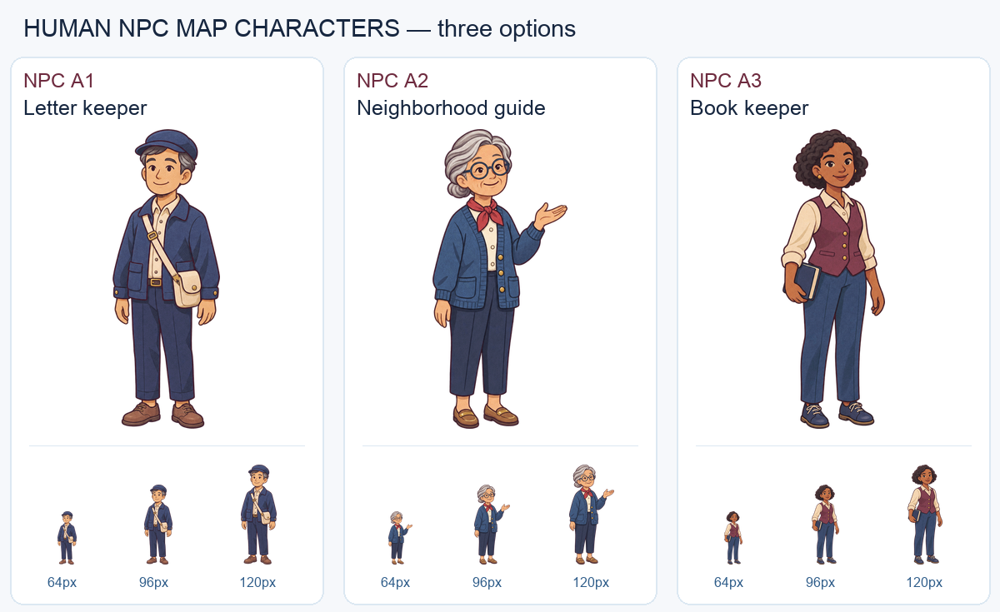
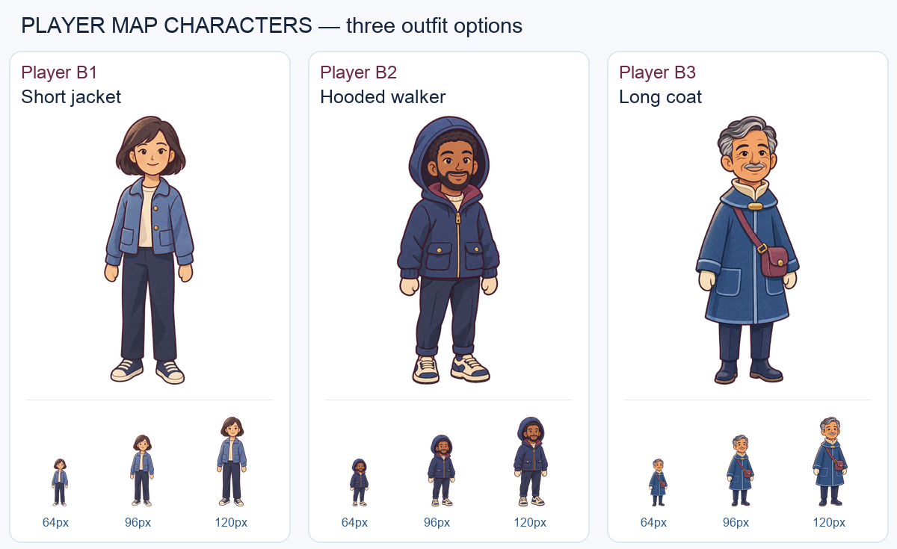

# Brainstorm only: full-body map characters

These are brainstorming sketches, not an approved design or implementation plan.
No character, NPC role, outfit, profile-head technique or map integration has
been selected or agreed. The labels are suggestions from Codex only.

Roy requested three human NPC options and three player options in the approved
Time Capsule style, generated with the built-in **GPT Image 2** tool. These are
complete standing map figures with visible bodies, two legs and both shoes.

| NPC | Player outfit (example face) |
|---|---|
| A1 — Letter keeper | B1 — Short jacket |
| A2 — Neighborhood guide | B2 — Hooded walker |
| A3 — Book keeper | B3 — Long coat |





[120 px map comparison](_checks/map-size-review.png) uses unchanged pixels from
the existing map screenshot as a static backdrop, not a new map or app wiring.

The player faces are illustrative examples. Separate head/face layers and masks
were one possible technical direction suggested by Codex, not a decision by
Roy or authorized follow-up work. The PNGs are brainstorming illustrations,
not finished modular sprites or animation sheets.

All six normalized masters are 1024×1024 RGBA with transparent corners and a
common foot anchor at **(512, 900)**. Only scale and placement were normalized;
the generated figures were not redrawn. Original outputs are retained under
`_checks/source-*.png`; `prompts.json` records every exact generation prompt.
The 512 px WebP previews use quality 85 and retain transparency.

`_checks/checks.json` and `_checks/master-audit.json` record the six passing
canvas/alpha checks. The review sheets show actual 64/96/120 px character
heights. The full legacy asset checker also flags twelve existing game images
under its old dimension/opacity expectations; those images and checker rules
are unchanged.

Rebuild the concept layout and reviews with an environment containing Pillow:

```sh
python design/art/scripts/prepare-map-character-options.py
```

No app registration, map integration, migration or deployment is included.
Keep this as brainstorming reference only. No selection, approval, merge or
follow-up implementation is pending from this request.
