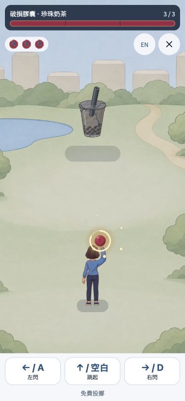
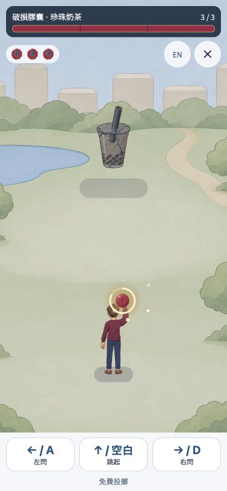
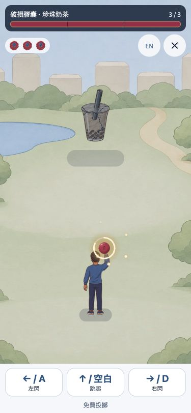
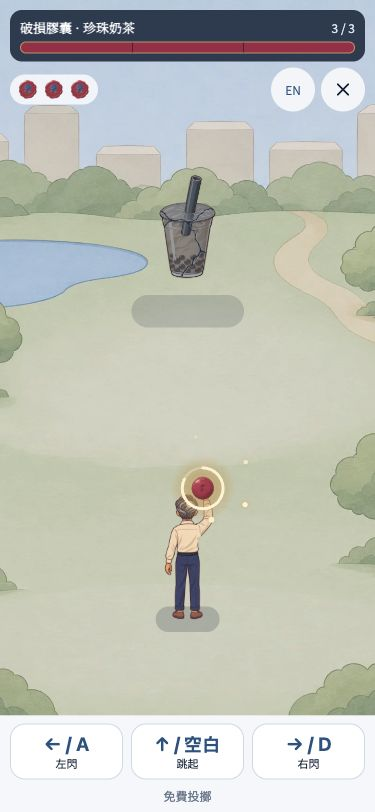
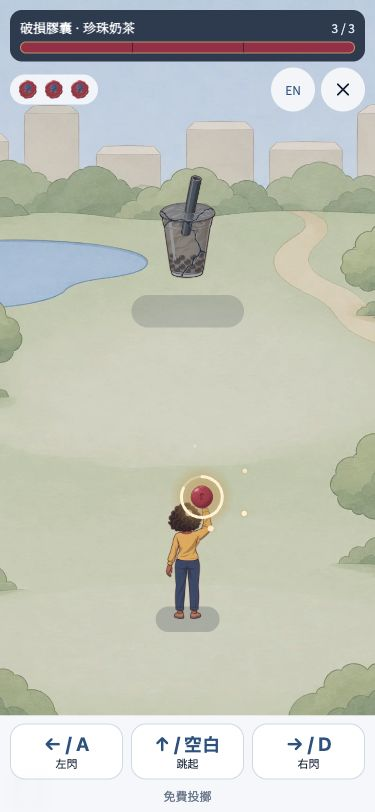

# DF2 back-view rig review

The Expo fight screen was checked at 375 × 812 and 1440 × 900. A temporary local fixture held the poses in the real screen so the feet anchors and release points could be measured. Each figure was inspected in all three grounded lanes and in the step, jump, gather and release poses. The raised arm still appears when Reduce Motion is on.

## 375 px gathering

| 01 | 02 | 03 | 04 |
|---|---|---|---|
|  |  |  |  |
| **05** | **06** | **07** | **08** |
|  |  |  |  |
