# Production polish review

All captures are 390 × 844. Before captures use production `a3cdbcd`; after captures use the local branch against the same hosted test data. No capsule was sent while capturing the draft seal gesture.

| Fix | Before | After |
| --- | --- | --- |
| English spacing on capsule page 1 | 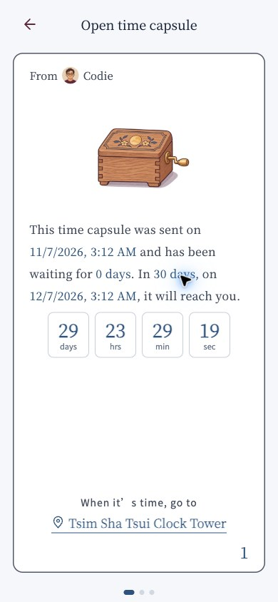 | 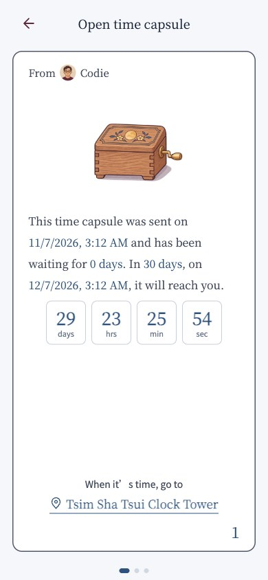 |
| Scrolled Home card and active dot | 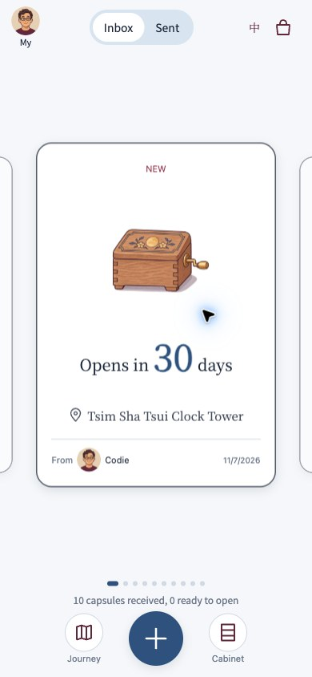 | 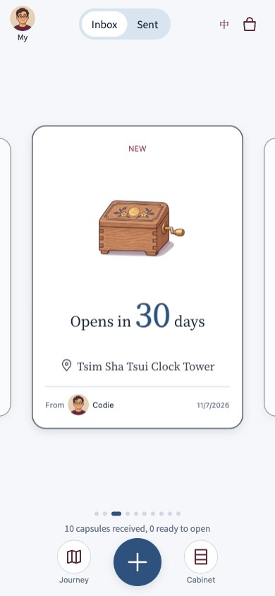 |
| Seal dragged onto the letter | 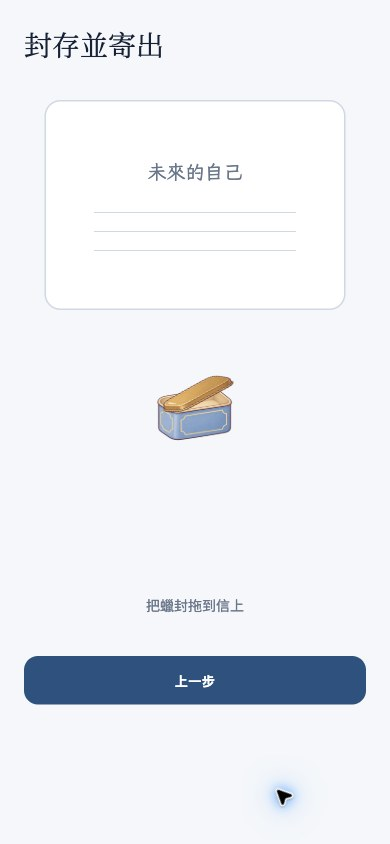 | 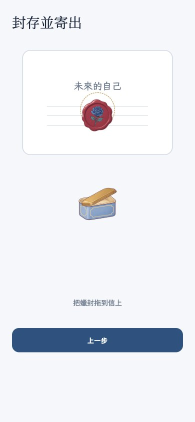 |

The Home captures show the same third card: before, dot 1 stays active; after, dot 3 is active. Both English story text and the destination lead-in use zero added letter spacing; Chinese retains its spacing. Sign-in already applied spacing only in Chinese.

## Seal hint: three-frame strip

Actual browser captures taken roughly 400 ms apart during the repeating 1.2 s brass-chevron cycle:

| Frame 1 | Frame 2 | Frame 3 |
| --- | --- | --- |
| 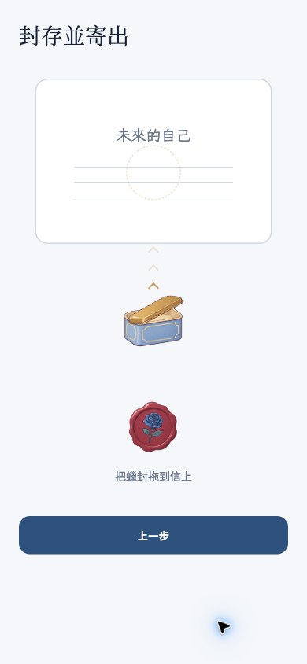 | 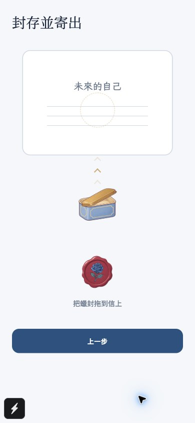 |  |

The dashed circle shares the stamped seal's position. Touching the wax fades the chevrons in 160 ms and stops its idle nudge. Target opacity follows the distance to the spot. The dragged seal has z-index 10 and Android elevation 10. The after-drag capture also shows the brighter target and hidden chevrons.

[Reduce Motion capture](reduced-motion.jpg): static chevrons and target, with seal y-position unchanged across two samples 900 ms apart. Both languages were checked in the ceremony. No new text was added.

Validation: mobile unit tests, TypeScript, web export, browser horizontal scrolling, drag overlap, guide cycle, touch fade, target proximity, and Reduce Motion. PR CI must pass before release.

Local run: `cd mobile && npm run web -- --port 8083` → http://localhost:8083.

## Capsule pager, map badge, and swipe discovery

| Capsule first page and discovery hint | Map page with vessel pin | Final page, plain serif number |
| --- | --- | --- |
| 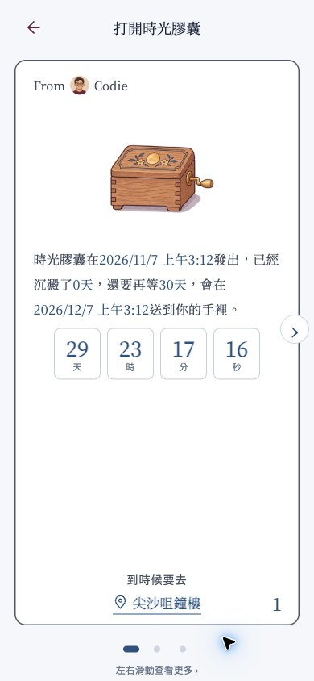 | 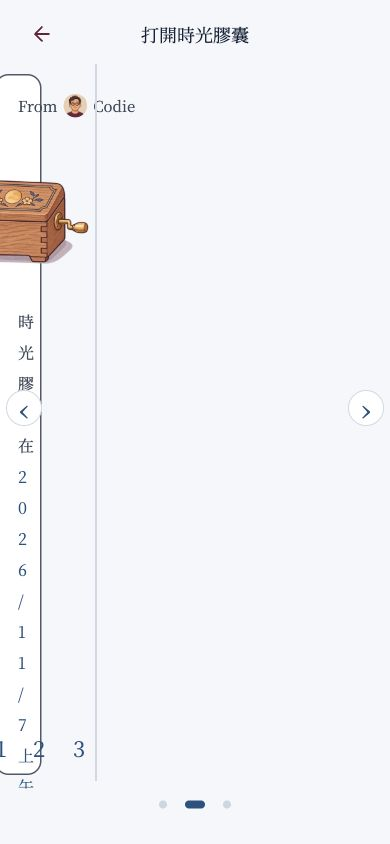 | 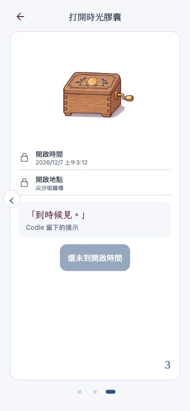 |

| Home with pointer arrows and animated pill | Home with touch emulation (arrows hidden) |
| --- | --- |
| 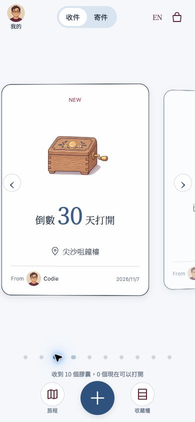 | 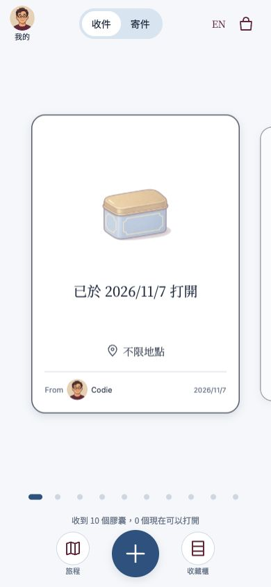 |

Both pagers update from scroll offsets. The shared dots have 8 px inactive circles, a 20 px active pill, and 32 px tap targets. Pointer media queries control the arrows. The capsule's discovery nudge and dismissed hint are stored in AsyncStorage per device; the nudge is skipped under Reduce Motion. Page changes keep the selection haptic, and page numbers share one component and position.

The web map iframe is explicitly below the radius SVG and vessel badge. Native markers use a fixed 64 × 76 view, z-index 1000, bottom anchor for Google Maps, and centre offset for MapKit. The white badge has a brass ring and a tail whose bottom centre is the coordinate. Native marker behavior was checked against the [react-native-maps Marker API](https://github.com/react-native-maps/react-native-maps/blob/master/docs/marker.md); iOS export checks the native code, while physical-device rendering remains Roy's phone check. The embedded [OpenStreetMap reference](https://www.openstreetmap.org/) was inspected in the browser at the stored place coordinates. Geography, coordinates, and radius are unchanged. The local map capture includes the existing development-only simulated-arrival control, which is excluded from production.
